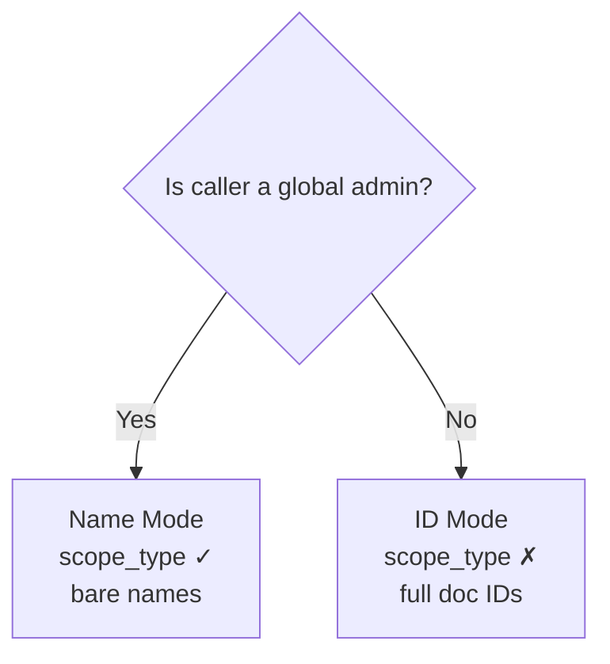

---
tags:
  - how-to
  - access-control
  - curl
  - intermediate
title: Access Grant with Capabilities API — Name Mode vs ID Mode
nextjs:
  metadata:
    title: TerminusDB Access Grants with Capabilities API — Name Mode vs ID Mode
    description: How to grant and revoke permissions using the two calling modes of the TerminusDB capabilities API. Includes worked examples, error diagnosis, and guidance for application developers.
    keywords: terminusdb capabilities, terminusdb grant, terminusdb revoke, scope_type, access control modes, capabilities API, grant permissions, RBAC
    openGraph:
      images: https://assets.terminusdb.com/docs/technical-documentation-terminuscms-og.png
    alternates:
      canonical: https://terminusdb.com/docs/capabilities-api-modes/
---

The TerminusDB `/api/capabilities` endpoint supports two distinct calling modes. Choosing the wrong mode — or mixing elements from both — yields errors. This guide explains when to use each mode and how to avoid the most common mistakes.


For a beginner introduction to access control, see the [Access Control Tutorial](/docs/access-control-tutorial). For the full endpoint reference, see [Access Control Reference](/docs/access-control).


## The two modes

| | Name Mode | ID Mode |
|---|---|---|
| **When to use** | Caller has `manage_capabilities` on SystemDatabase (typically the global admin) | Caller has `manage_capabilities` on a specific organisation only |
| **`scope_type` field** | Required (`"organization"` or `"database"`) | Must be omitted |
| **`user` field** | Bare username (e.g. `"x_alice"`) | Full document ID (e.g. `"User/x_alice"`) |
| **`scope` field** | Bare resource name — org name or `"org/db"` path | Full resource ID (e.g. `"Organization/x_myteam"` or `"UserDatabase/<hash>"`) |
| **`roles` field** | Role display names (e.g. `["Consumer Role"]`) | Full document IDs (e.g. `["Role/consumer"]`) |
| **Permission required** | `manage_capabilities` on `system` (global admin) | `manage_capabilities` on the target resource |


If you include `scope_type` but use document IDs for `user` or `roles`, the request will fail. Conversely, if you omit `scope_type` but send bare names, TerminusDB cannot resolve them and returns an error.


## Prerequisites — create the example resources

The examples below work with two users (`x_alice`, and `x_orgadmin` who administrates the organisation), a custom `x_writer` role, the organisation `x_myteam`, and its database `x_salesdata`. The `x_` prefix keeps them easy to spot and safe to delete. Use the widget to create (and later delete) them in one click — it talks to `localhost:6363`, or whatever server you have configured in the connection settings:



## Name Mode — global admin

Name Mode is the simpler calling convention. TerminusDB resolves human-readable names to internal document IDs on your behalf. It requires the `scope_type` field, and the caller must have `manage_capabilities` on the SystemDatabase — the full global admin capability set.

### Grant a role on an organisation

```bash
curl -s -u admin:root -X POST http://localhost:6363/api/capabilities \
  -H "Content-Type: application/json" \
  -d '{
    "operation": "grant",
    "scope_type": "organization",
    "scope": "x_myteam",
    "user": "x_alice",
    "roles": ["Consumer Role"]
  }'
```

**Response (200):**
```json
{"@type": "api:CapabilityResponse", "api:status": "api:success"}
```

Verify the grant landed:

```bash
curl -s -u admin:root "http://localhost:6363/api/users/x_alice?capability=true"
# Response lists x_alice's capabilities, including Role/consumer on Organization/x_myteam
```

### Grant a role on a specific database

```bash
curl -s -u admin:root -X POST http://localhost:6363/api/capabilities \
  -H "Content-Type: application/json" \
  -d '{
    "operation": "grant",
    "scope_type": "database",
    "scope": "x_myteam/x_salesdata",
    "user": "x_alice",
    "roles": ["x_writer"]
  }'
```

The `scope` field uses the path format `"orgName/dbName"` when `scope_type` is `"database"`.

### Revoke a role

```bash
curl -s -u admin:root -X POST http://localhost:6363/api/capabilities \
  -H "Content-Type: application/json" \
  -d '{
    "operation": "revoke",
    "scope_type": "organization",
    "scope": "x_myteam",
    "user": "x_alice",
    "roles": ["Consumer Role"]
  }'
```

## ID Mode — delegated admin

ID Mode is required when the caller is not the global admin but has `manage_capabilities` on a specific organisation. Since TerminusDB cannot perform system-wide name resolution for non-global callers, you must provide full document IDs for every field.

### Set up the delegated admin

The ID Mode examples authenticate as `x_orgadmin`. As the global admin, give `x_orgadmin` the `Admin Role` (which includes `manage_capabilities`) on `x_myteam` — using Name Mode, since the caller is global admin:

```bash
curl -s -u admin:root -X POST http://localhost:6363/api/capabilities \
  -H "Content-Type: application/json" \
  -d '{
    "operation": "grant",
    "scope_type": "organization",
    "scope": "x_myteam",
    "user": "x_orgadmin",
    "roles": ["Admin Role"]
  }'
```

### Find the document IDs you need

Before making a grant call in ID Mode, you need the internal IDs. The admin user can look these up:

```bash
# Get user ID
curl -s -u admin:root http://localhost:6363/api/users/x_alice
# Response includes: "@id": "User/x_alice"

# Get organisation ID
curl -s -u admin:root http://localhost:6363/api/organizations
# Response includes: "@id": "Organization/x_myteam"

# Get role ID
curl -s -u admin:root http://localhost:6363/api/roles
# Response includes: "@id": "Role/consumer", "name": "Consumer Role"

# Get database ID (for database-scoped grants)
curl -s -u admin:root "http://localhost:6363/api/db/x_myteam?verbose=true"
# Response includes database objects with "@id": "UserDatabase/UPQP7yxgYzJQfM5p"
```

The database `@id` is a hash that differs between servers — you cannot copy it from the docs. Capture it into a shell variable so the calls below work when pasted verbatim:

```bash
DB_ID=$(curl -s -u admin:root "http://localhost:6363/api/db/x_myteam?verbose=true" \
  | python3 -c "import json,sys; print(json.load(sys.stdin)[0]['@id'])")
echo "$DB_ID"   # e.g. UserDatabase/UPQP7yxgYzJQfM5p
```

### Grant a role on an organisation (ID Mode)

```bash
curl -s -u x_orgadmin:password -X POST http://localhost:6363/api/capabilities \
  -H "Content-Type: application/json" \
  -d '{
    "operation": "grant",
    "scope": "Organization/x_myteam",
    "user": "User/x_alice",
    "roles": ["Role/consumer"]
  }'
```

Notice: **no `scope_type` field**. All identifiers use their full document ID form.

### Grant a role on a database (ID Mode)

```bash
curl -s -u x_orgadmin:password -X POST http://localhost:6363/api/capabilities \
  -H "Content-Type: application/json" \
  -d '{
    "operation": "grant",
    "scope": "'$DB_ID'",
    "user": "User/x_alice",
    "roles": ["Role/x_writer"]
  }'
```

For database scope in ID Mode, the `scope` is the database's internal `@id`, not the `"org/db"` path format. The `'$DB_ID'` quoting expands the variable captured above inside the single-quoted JSON — paste it as-is.

### Revoke a role (ID Mode)

```bash
curl -s -u x_orgadmin:password -X POST http://localhost:6363/api/capabilities \
  -H "Content-Type: application/json" \
  -d '{
    "operation": "revoke",
    "scope": "Organization/x_myteam",
    "user": "User/x_alice",
    "roles": ["Role/consumer"]
  }'
```

## Error diagnosis

### Errors due to bare names without `scope_type`

**Symptom:** You send bare names but omit `scope_type`.

```bash
# ❌ BROKEN: bare names without scope_type
curl -s -u admin:root -X POST http://localhost:6363/api/capabilities \
  -H "Content-Type: application/json" \
  -d '{
    "operation": "grant",
    "scope": "x_myteam",
    "user": "x_alice",
    "roles": ["Consumer Role"]
  }'
```

**Why it fails:** Without `scope_type`, TerminusDB treats `"x_alice"` as a document ID. There is no document with `@id` equal to `"x_alice"` — the actual ID is `"User/x_alice"`. The server cannot resolve the reference and returns 500.

**Fix:** Either add `scope_type` (Name Mode) or use full document IDs (ID Mode).

### Error with document IDs with `scope_type`

**Symptom:** You send `scope_type` but also use document ID format.

```bash
# ❌ BROKEN: scope_type present but IDs used instead of names
curl -s -u admin:root -X POST http://localhost:6363/api/capabilities \
  -H "Content-Type: application/json" \
  -d '{
    "operation": "grant",
    "scope_type": "organization",
    "scope": "Organization/x_myteam",
    "user": "User/x_alice",
    "roles": ["Role/consumer"]
  }'
```

**Why it fails:** With `scope_type`, TerminusDB wraps your values with type prefixes automatically. `"Organization/x_myteam"` becomes `"Organization/Organization/x_myteam"` — which does not exist.

**Fix:** Remove the type prefixes — use bare names when `scope_type` is present.

### Schema check failure — an ID that doesn't resolve

**Symptom:** In ID Mode, the request fails with `"api:message": "Schema check failure"` and a `system:witnesses` entry like this:

```json
{
  "@type": "references_untyped_object",
  "object": "terminusdb://system/data/UserDatabase/UPQP7yxgYzJQfM5p",
  "predicate": "http://terminusdb.com/schema/system#scope",
  "subject": "terminusdb://system/data/Capability/IBbWIbjbZ44FBq5B"
}
```

**Why it fails:** One of your document IDs doesn't point at an existing document. The witness `object` field tells you which reference is dangling — here, the `scope` predicate of the new capability points at a `UserDatabase` that doesn't exist. If the `object` field literally contains `<...>` or a doc example like `01AEV...`, a placeholder was pasted instead of a real ID. This typically happens with `scope`, `user`, or `roles` in ID Mode.

**Fix:** Look up the real `@id` values (see [Find the document IDs you need](#find-the-document-ids-you-need)) and substitute them — database IDs are hash-based and differ between servers.

### 403 Forbidden — insufficient capabilities

**Symptom:** A non-admin user tries to use Name Mode.

```bash
# ❌ FAILS: x_orgadmin does not have manage_capabilities on SystemDatabase
curl -s -u x_orgadmin:password -X POST http://localhost:6363/api/capabilities \
  -H "Content-Type: application/json" \
  -d '{
    "operation": "grant",
    "scope_type": "organization",
    "scope": "x_myteam",
    "user": "x_alice",
    "roles": ["Consumer Role"]
  }'
```

**Why it fails:** Name-based resolution (`scope_type`) requires `manage_capabilities` on the **SystemDatabase** — a global admin privilege. Organisation-level admins must use ID Mode.

**Fix:** Remove `scope_type` and switch to full document IDs.

## Decision guide for application developers

When building an application that manages capabilities programmatically:

1. **Determine the caller's privilege level at runtime.** Does the authenticated user have global admin access (e.g. username `"admin"`, or a user with `manage_capabilities` on SystemDatabase)?

2. **Choose the mode based on privilege:**
   - Global admin → **Name Mode** (simpler, no ID lookups required)
   - Organisation admin → **ID Mode** (must look up or cache document IDs)

3. **Never default to one mode unconditionally.** If your code always omits `scope_type` but sends bare names, it will break. If it always sends `scope_type` but the user lacks global admin, it will get 403.



## Summary

| Scenario | Mode | `scope_type` | Identifiers |
|----------|------|:---:|---|
| Admin grants user access to a team | Name | `"organization"` | `user: "x_alice"`, `scope: "x_myteam"` |
| Admin grants user access to a database | Name | `"database"` | `user: "x_alice"`, `scope: "x_myteam/x_salesdata"` |
| Org admin grants user access to their team | ID | omit | `user: "User/x_alice"`, `scope: "Organization/x_myteam"` |
| Org admin grants user access to a database | ID | omit | `user: "User/x_alice"`, `scope: "UserDatabase/<hash>"` |
| Admin revokes from a team | Name | `"organization"` | `user: "x_alice"`, `scope: "x_myteam"`, `roles: ["Consumer Role"]` |
| Org admin revokes from a team | ID | omit | `user: "User/x_alice"`, `scope: "Organization/x_myteam"`, `roles: ["Role/consumer"]` |

## Clean up

Once you are done experimenting, remove the resources created in the prerequisites — the widget below (same one as at the top) deletes all of them in one click, including revoking the capabilities granted along the way.




The following commands **permanently delete** the `x_salesdata` database (including all documents, schema, and commit history), the `x_myteam` organisation (including all capabilities granted on it), the `x_alice` and `x_orgadmin` user accounts, and the custom `x_writer` role. Run them only against the throwaway resources from this guide — never against production resources.


Or delete them with curl. The order matters — grants must be revoked first, because TerminusDB refuses to delete a resource that a capability still references (`DanglingOrganizationReferencedError`), and a database must go before its organisation:

```bash
# Capture the database's internal ID (needed for the db-scoped revoke)
DB_ID=$(curl -s -u admin:root "http://localhost:6363/api/db/x_myteam?verbose=true" \
  | python3 -c "import json,sys; print(json.load(sys.stdin)[0]['@id'])")

# Revoke the grants made in this guide (all roles on each user+scope pair)
curl -s -u admin:root -X POST http://localhost:6363/api/capabilities \
  -H "Content-Type: application/json" \
  -d '{"operation": "revoke", "scope": "Organization/x_myteam", "user": "User/x_alice", "roles": ["Role/consumer"]}'

curl -s -u admin:root -X POST http://localhost:6363/api/capabilities \
  -H "Content-Type: application/json" \
  -d '{"operation": "revoke", "scope": "'$DB_ID'", "user": "User/x_alice", "roles": ["Role/x_writer"]}'

curl -s -u admin:root -X POST http://localhost:6363/api/capabilities \
  -H "Content-Type: application/json" \
  -d '{"operation": "revoke", "scope": "Organization/x_myteam", "user": "User/x_orgadmin", "roles": ["Role/admin"]}'

# Delete the database
curl -s -u admin:root -X DELETE "http://localhost:6363/api/db/x_myteam/x_salesdata"

# Delete the organisation
curl -s -u admin:root -X DELETE http://localhost:6363/api/organizations/x_myteam

# Delete the users
curl -s -u admin:root -X DELETE http://localhost:6363/api/users/x_alice
curl -s -u admin:root -X DELETE http://localhost:6363/api/users/x_orgadmin

# Delete the custom role
curl -s -u admin:root -X DELETE http://localhost:6363/api/roles/x_writer
```

## See Also

- [Access Control Reference](/docs/access-control) — Full API reference for users, roles, and capabilities
- [Access Control Tutorial](/docs/access-control-tutorial) — Beginner walkthrough
- [Troubleshooting Authentication Errors](/docs/troubleshooting-auth) — Connection and auth issue diagnosis
